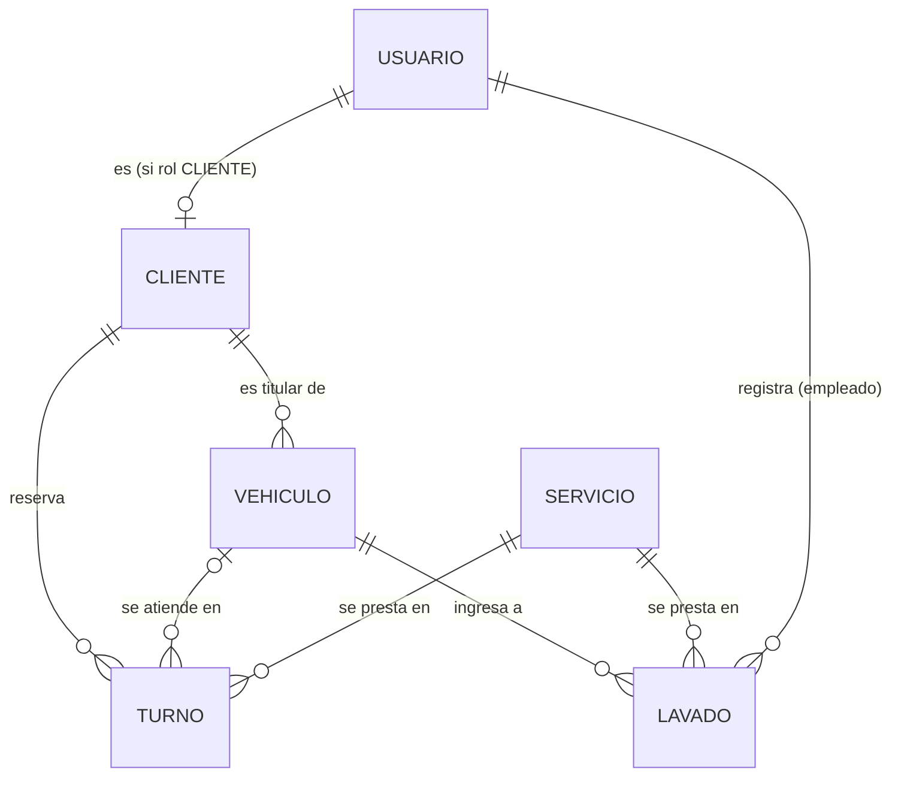

# Modelo de Dominio — SGI San José

Verificación del modelo (AG-C13) actualizada con lo que terminó implementado en el
backend (`backend/prisma/schema.prisma`). La versión anterior guardaba el vehículo como
texto dentro del cliente; desde la migración `20261020120000_vehiculos_lavados_estado_turno`
el vehículo es una entidad propia, que es lo que pedía el dominio desde la Fase 1
(un cliente puede tener varios autos y el historial es del auto, no de la persona).

## Diagrama de relaciones

## Entidades

### Usuario
Cuenta para entrar al sistema. Roles: `ADMIN`, `EMPLEADO`, `CLIENTE`.
- **id**, **email** (único), **nombre**, **passwordHash** (bcrypt, nunca se devuelve), **rol**, **createdAt**

### Cliente
Ficha de la persona que trae autos. Puede existir sin cuenta (la carga el personal en el
mostrador) o estar vinculada a una cuenta `CLIENTE` (se registró en la web).
- **id**, **nombre**, **telefono**, **email** (único, opcional), **createdAt**
- **usuarioId** (único, opcional) → `Usuario`

Si alguien se registra con un email que el lubricentro ya tenía cargado, la cuenta se
vincula a esa ficha y el cliente ve su historial desde el primer login.

### Vehiculo
- **id**, **patente** (única, normalizada: sin espacios ni guiones, en mayúsculas; formatos AAA123 y AA123BB)
- **marca**, **modelo**, **anio** (opcional), **km**
- **kmUltimoService**, **fechaUltimoService**: con estos datos se calcula el **próximo service**
  (cada 10.000 km o 6 meses, lo que pase primero). El estado (`ok`, `proximo`, `vencido`,
  `sin-datos`) no se guarda: depende de la fecha de hoy y lo calcula la API en cada respuesta.
- **clienteId** → `Cliente`

### Servicio
Catálogo del negocio.
- **id**, **nombre**, **precio**, **desc**, **tipo** (`lavadero` | `lubricentro`)

### Turno
Reserva anticipada.
- **id**, **fecha** (AAAA-MM-DD), **hora** (uno de los horarios de atención: cada 30 minutos de 08:00 a 17:30)
- **estado**: `PENDIENTE → CONFIRMADO → EN_PROCESO → COMPLETADO`, o `CANCELADO` (ver *Diagrama de Estado.jpeg*)
- **nota** (opcional), **createdAt**
- **clienteId** → `Cliente`, **vehiculoId** (opcional) → `Vehiculo`, **servicioId** → `Servicio`

Reglas: un horario admite un solo turno activo (los cancelados liberan el lugar); el vehículo
tiene que ser del cliente; un `CLIENTE` siempre reserva a nombre de su propia ficha y solo puede
cancelar sus turnos pendientes o confirmados. Al completar un turno de lubricentro se registra el
service del vehículo.

### Lavado
Auto que entra al lavadero **sin turno** y se registra al ingresar.
- **id**, **fecha** (fecha y hora del ingreso), **precio** (copia del precio del servicio en ese
  momento: si después cambia el precio, la caja de ese día no se altera), **observaciones**
- **vehiculoId** → `Vehiculo`, **servicioId** → `Servicio` (tiene que ser de tipo lavadero),
  **empleadoId** → `Usuario` (quien estaba logueado al registrarlo)

## Relaciones y `onDelete` (decididos a conciencia, C17)

| Relación | Tipo | onDelete | Por qué |
| :--- | :---: | :---: | :--- |
| Usuario → Cliente | 1:0..1 | SetNull | Si se borra la cuenta, la ficha y su historial se conservan. |
| Cliente → Vehiculo | 1:N | Cascade | Un auto no tiene sentido sin su titular. |
| Cliente → Turno | 1:N | Restrict | No se borra un cliente con turnos: se perdería el historial. |
| Vehiculo → Turno | 1:N | SetNull | El turno queda en el historial aunque se dé de baja el auto. |
| Servicio → Turno | 1:N | Restrict | No se borra un servicio que ya se usó. |
| Vehiculo → Lavado | 1:N | Restrict | Los lavados son la caja del día. |
| Servicio → Lavado | 1:N | Restrict | Idem. |
| Usuario → Lavado | 1:N | Restrict | Queda registrado qué empleado lo hizo. |

Combinadas: borrar un cliente **sin** turnos borra sus vehículos (Cascade); si **tiene** turnos,
Postgres frena toda la operación (Restrict) y la API responde `409`.

## Migración de datos existentes

La base ya tenía clientes con el vehículo como texto. La migración, antes de borrar esas columnas,
crea un `Vehiculo` por cliente (patente normalizada; "Marca Modelo" partido en el primer espacio)
y vincula cada turno existente al vehículo de su cliente, en estado `PENDIENTE`.
