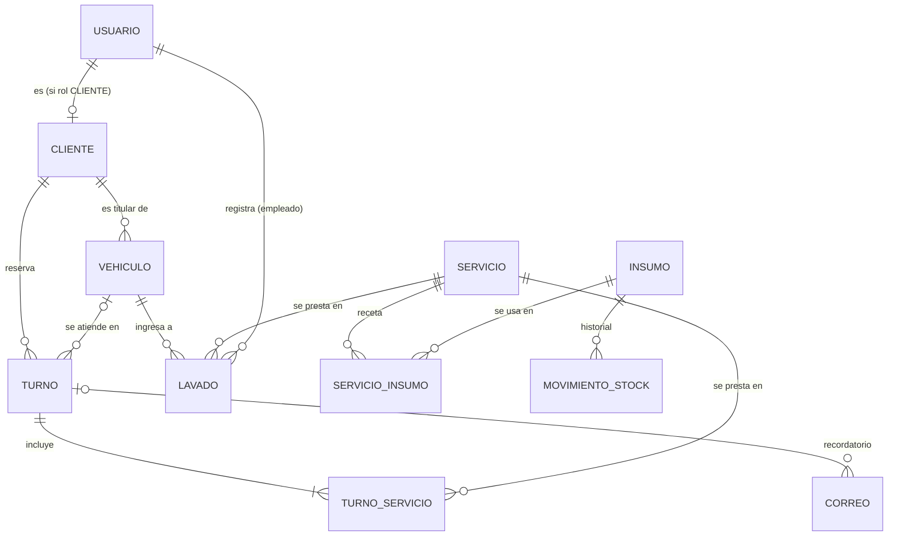

# Modelo de Dominio — SGI San José

Verificación del modelo (AG-C13) actualizada con lo que terminó implementado en el
backend (`backend/prisma/schema.prisma`). La versión anterior guardaba el vehículo como
texto dentro del cliente; desde la migración `20261020120000_vehiculos_lavados_estado_turno`
el vehículo es una entidad propia, que es lo que pedía el dominio desde la Fase 1
(un cliente puede tener varios autos y el historial es del auto, no de la persona).

## Diagrama de relaciones

## Entidades

### Usuario
Cuenta para entrar al sistema. Roles: `ADMIN`, `EMPLEADO`, `CLIENTE`.
- **id**, **email** (único), **nombre**, **passwordHash** (bcrypt, nunca se devuelve), **rol**, **createdAt**

### Cliente
Ficha de la persona que trae autos. Puede existir sin cuenta (la carga el personal en el
mostrador) o estar vinculada a una cuenta `CLIENTE` (se registró en la web).
- **id**, **nombre**, **dni** (único, opcional; se guarda sin puntos), **telefono**, **email** (único, opcional), **createdAt**
- **usuarioId** (único, opcional) → `Usuario`

Si alguien se registra con un email que el lubricentro ya tenía cargado, la cuenta se
vincula a esa ficha y el cliente ve su historial desde el primer login.

### Vehiculo
- **id**, **patente** (única, normalizada: sin espacios ni guiones, en mayúsculas; formatos AAA123 y AA123BB)
- **marca**, **modelo**, **anio** (opcional), **km**
- **kmUltimoService**, **fechaUltimoService**: con estos datos se calcula el **próximo service**
  (cada 10.000 km o 6 meses, lo que pase primero). El estado (`ok`, `proximo`, `vencido`,
  `sin-datos`) no se guarda: depende de la fecha de hoy y lo calcula la API en cada respuesta.
- **clienteId** → `Cliente`

### Servicio
Catálogo del negocio.
- **id**, **nombre**, **precio**, **desc**, **tipo** (`lavadero` | `lubricentro`)

### Turno
Reserva anticipada.
- **id**, **fecha** (AAAA-MM-DD), **hora** (uno de los horarios de atención: cada 30 minutos de 08:00 a 17:30)
- **estado**: `PENDIENTE → CONFIRMADO → EN_PROCESO → COMPLETADO`, o `CANCELADO` (ver *Diagrama de Estado.jpeg*)
- **nota** (opcional), **createdAt**
- **stockDescontado**: evita descontar insumos dos veces si el turno se vuelve a completar
- **recordatorioEnviado**: el recordatorio automático sale una sola vez
- **clienteId** → `Cliente`, **vehiculoId** (opcional) → `Vehiculo`
- **servicios** → `Servicio` (N:M a través de `TurnoServicio`): uno o más por turno

Reglas: un horario admite un solo turno activo (los cancelados liberan el lugar); el vehículo
tiene que ser del cliente; un `CLIENTE` siempre reserva a nombre de su propia ficha y solo puede
cancelar sus turnos pendientes o confirmados. **Sin vehículo no se reserva** (la columna sigue siendo
opcional porque, si después se borra el auto, el turno terminado queda en el historial con `SetNull`).
Un turno puede incluir varios servicios, pero como
máximo **uno de tipo lavadero** (no tiene sentido un Lavado Básico y un Premium juntos); los de
lubricentro se combinan libremente. Al completarlo se descuentan los insumos de cada servicio y,
si incluye alguno de lubricentro, se registra el service del vehículo. Su precio es la suma de
sus servicios.

### TurnoServicio (N:M explícita)
Tabla intermedia entre `Turno` y `Servicio`. Clave compuesta (**turnoId**, **servicioId**).
Es **explícita** (y no la implícita de Prisma) para poder decidir el `onDelete` de cada lado.
La migración `20261027120000_turno_varios_servicios` copió el `servicioId` de cada turno existente
a esta tabla antes de borrar la columna: ningún turno perdió su servicio.

### Lavado
Auto que entra al lavadero **sin turno** y se registra al ingresar.
- **id**, **fecha** (fecha y hora del ingreso), **precio** (copia del precio del servicio en ese
  momento: si después cambia el precio, la caja de ese día no se altera), **observaciones**
- **vehiculoId** → `Vehiculo`, **servicioId** → `Servicio` (tiene que ser de tipo lavadero),
  **empleadoId** → `Usuario` (quien estaba logueado al registrarlo)

### Insumo
Productos que consume el taller (Visión y Alcance 5.1, control de insumos).
- **id**, **nombre** (único), **unidad** (`litros` | `unidades`), **stock**, **stockMinimo**, **createdAt**
- Está "bajo" cuando `stock <= stockMinimo`: aparece la alerta en Insumos, en el menú y en el panel.

### ServicioInsumo (receta)
Qué insumos consume un servicio cada vez que se hace. Clave compuesta (**servicioId**, **insumoId**) + **cantidad**.
Al completar un turno o registrar un lavado se descuenta según la receta; si no alcanza, el stock queda
en 0 (el trabajo ya se hizo, no se frena) y el insumo queda en alerta.

### MovimientoStock
Historial de cada insumo: **cantidad** (positiva = carga, negativa = consumo o ajuste), **motivo**, **fecha**.
El stock no se edita directo: siempre se mueve con un movimiento, así queda registrado por qué cambió.

### Correo
Registro de cada recordatorio: **destinatario**, **asunto**, **cuerpo**, **estado** (`ENVIADO` | `SIMULADO` | `FALLIDO`),
**error**, **createdAt**, **turnoId** (opcional). Sin SMTP configurado queda `SIMULADO`.

## Relaciones y `onDelete` (decididos a conciencia, C17)

| Relación | Tipo | onDelete | Por qué |
| :--- | :---: | :---: | :--- |
| Usuario → Cliente | 1:0..1 | SetNull | Si se borra la cuenta, la ficha y su historial se conservan. |
| Cliente → Vehiculo | 1:N | Cascade | Un auto no tiene sentido sin su titular. |
| Cliente → Turno | 1:N | Restrict | No se borra un cliente con turnos: se perdería el historial. |
| Vehiculo → Turno | 1:N | SetNull | El turno queda en el historial aunque se dé de baja el auto. |
| Turno → TurnoServicio | 1:N | Cascade | Los renglones son parte del turno: si se borra el turno, se van. |
| Servicio → TurnoServicio | 1:N | Restrict | No se borra un servicio que figura en algún turno: se perdería el historial (la API responde 409). |
| Vehiculo → Lavado | 1:N | Restrict | Los lavados son la caja del día. |
| Servicio → Lavado | 1:N | Restrict | Idem. |
| Usuario → Lavado | 1:N | Restrict | Queda registrado qué empleado lo hizo. |
| Servicio → ServicioInsumo | 1:N | Cascade | La receta es parte del servicio. |
| Insumo → ServicioInsumo | 1:N | Cascade | Si se borra un insumo, sale de las recetas. |
| Insumo → MovimientoStock | 1:N | Cascade | El historial pertenece al insumo. |
| Turno → Correo | 1:N | SetNull | El registro del envío queda aunque se borre el turno. |

Combinadas: borrar un cliente **sin** turnos borra sus vehículos (Cascade); si **tiene** turnos,
Postgres frena toda la operación (Restrict) y la API responde `409`.

## Migración de datos existentes

La base ya tenía clientes con el vehículo como texto. La migración, antes de borrar esas columnas,
crea un `Vehiculo` por cliente (patente normalizada; "Marca Modelo" partido en el primer espacio)
y vincula cada turno existente al vehículo de su cliente, en estado `PENDIENTE`.

La migración `20261021120000_insumos_dni_recordatorios` agrega las tablas de insumos y correos, el DNI del
cliente y los dos indicadores del turno. Como son columnas nuevas con valor por defecto o tablas nuevas,
no hay datos existentes que transformar.
